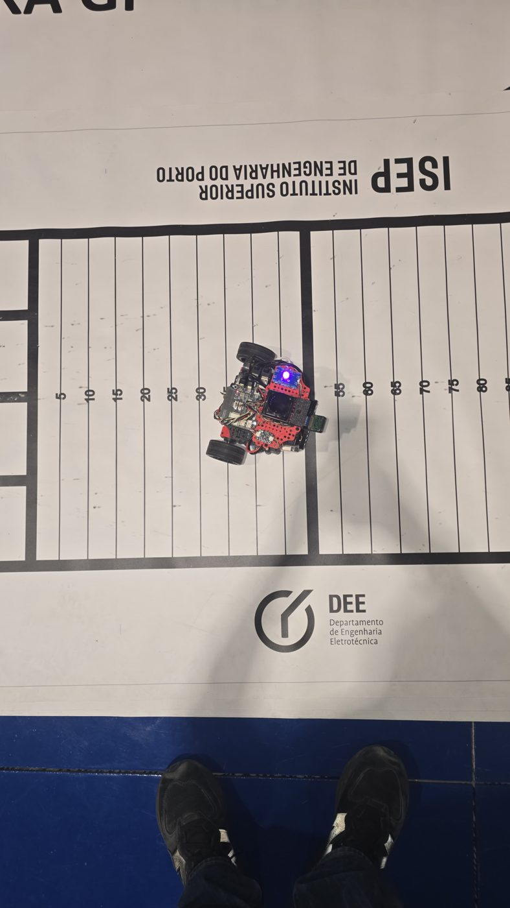
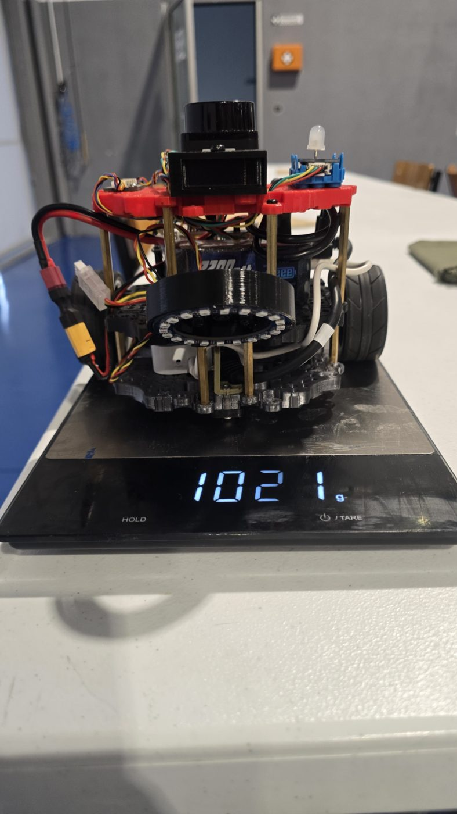

# Learn2Race

Learn2Race is a pair of small ROS 2 robots built for the ISEP Robotics Open competitions and for teaching mobile robotics. Both share one software architecture: a Raspberry Pi runs ROS 2 Jazzy, an ESP32 runs the wheels as a micro-ROS node, and a single drive-command mux with a safety supervisor sits between every source of motion and the motors.

<p align="center">
  
  
  
</p>
<p align="center"><em>Prototype A on the track and from the front; Prototype B with its stereo cameras.</em></p>

## The two robots

| | Prototype A | Prototype B |
|---|---|---|
| Purpose | Racing (TrackBotGP, Dragster) and teaching | Teaching and mapping |
| Computer | Raspberry Pi 4 | Raspberry Pi 5 |
| Drive | 2 geared DC motors with encoders, ESP32 on the Waveshare General Driver | 2 DDSM210 hub motors, ESP32 on the Waveshare DDSM Driver HAT |
| Main sensors | Line camera (IMX219), start-light sensor, IMU | 360° lidar, stereo cameras, 3 time-of-flight sensors, IMU |
| Main software | Camera line follower, race referee and state machine | SLAM Toolbox mapping, autonomous exploration, gamepad driving |
| Size | 180 × 206 × 158 mm, 1021 g | 228 × 188 × 177 mm, 1490 g |

## Repositories

This repository gathers the project. Each part is a separate repository, included here as a git submodule:

| Submodule | Contents |
|---|---|
| [`Learn2Race-PrototypeA`](https://github.com/rcfcpereira/Learn2Race-PrototypeA) | Prototype A: ESP32 firmware, ROS 2 workspace, run helper, installation and usage guides |
| [`Learn2Race-PrototypeB`](https://github.com/rcfcpereira/Learn2Race-PrototypeB) | Prototype B: ESP32 firmware, ROS 2 workspace, run helper, installation and usage guides |
| [`Learn2Race-PC-Control`](https://github.com/rcfcpereira/Learn2Race-PC-Control) | PC tools: gamepad driving over UDP, RViz map view, Gazebo race replay |

Clone everything at once:

```bash
git clone --recurse-submodules https://github.com/rcfcpereira/Learn2Race.git
```

Or, in a clone made without submodules:

```bash
git submodule update --init --recursive
```

On a robot, clone only that robot's repository (see its `INSTALL.md`).

## Getting started

1. **Network.** Put the robots and the PC on one network. The project uses a TP-Link TL-WR802N travel router: the robots on Ethernet with fixed addresses, and the PC on Wi-Fi.
2. **Robot.** Follow `INSTALL.md` in the robot's repository: Ubuntu 24.04 on the Pi, ROS 2 Jazzy, the workspace, device names and the ESP32 firmware.
3. **PC.** Follow `INSTALL.md` in Learn2Race-PC-Control: Python for the gamepad tool, and WSL with ROS 2 and Gazebo for RViz and the replay.
4. **Run.** Each robot is driven through `~/robot.sh`. See `USAGE.md` in its repository.

Both robots use ROS domain 0. Run one robot at a time on a shared network, or give each its own `ROS_DOMAIN_ID`.

## Architecture in short

```
 sources of motion                 safety                        hardware
 ─────────────────                 ──────                        ────────
 competition/cmd_vel ─┐
 autonomy/cmd_vel  ───┼──▶ cmd_vel_mux ──▶ /cmd_vel ──▶ micro-ROS agent ──▶ ESP32 ──▶ wheels
 teleop/cmd_vel    ───┘         ▲                                   │
                                │ fault / heartbeats                ▼
                         safety_monitor ◀──────────────────── /odom (20–25 Hz)
```

- The mux gives priority to competition, then autonomy, then teleoperation. A source that falls silent for 0.5 s is dropped.
- Autonomy drives only when armed.
- The safety monitor latches a fault when telemetry goes stale, and the ESP32 stops the motors by itself when commands stop arriving.

## Author

Ruben Pereira, ISEP – Instituto Superior de Engenharia do Porto, MSc dissertation, 2026.
